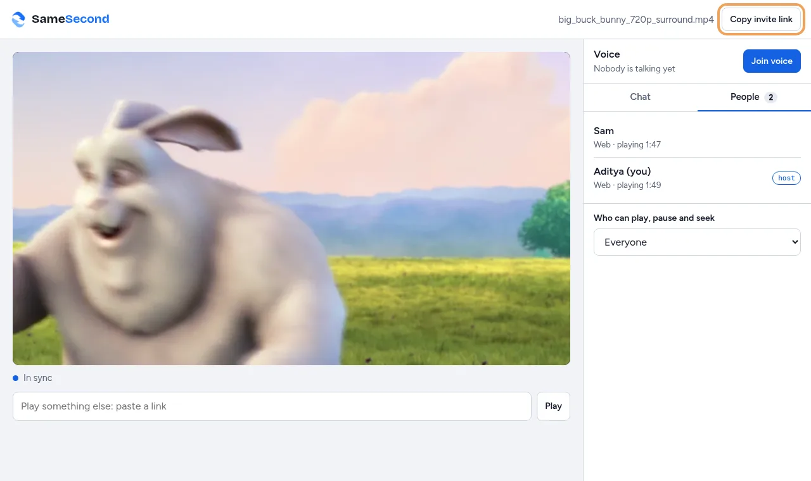
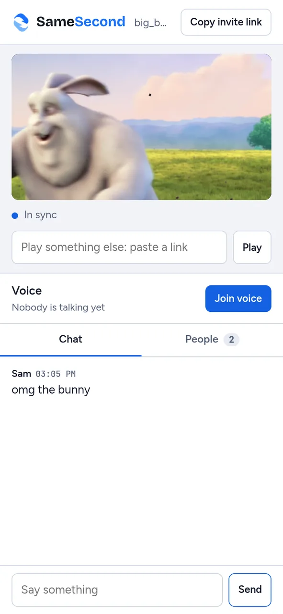
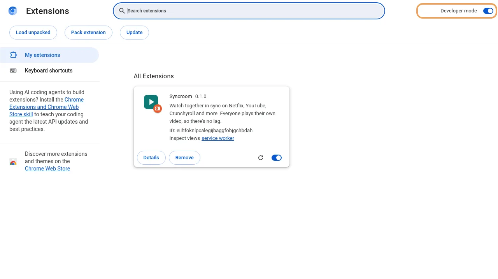
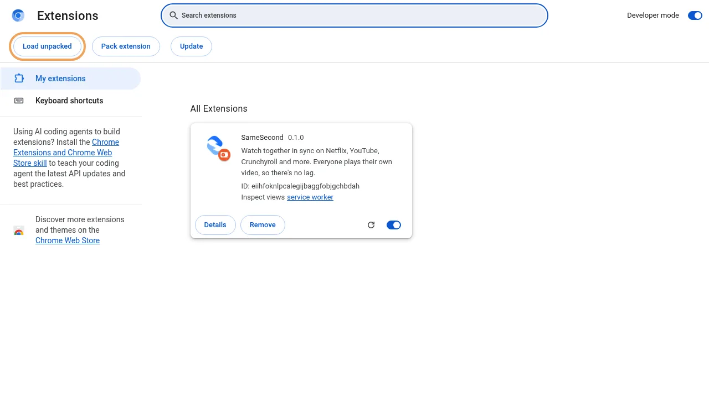
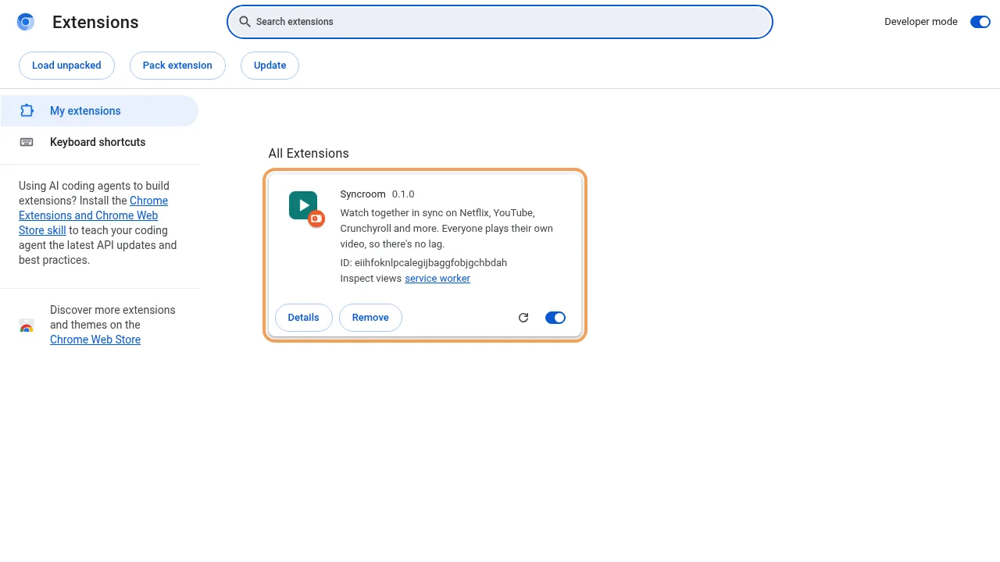

# Syncroom

Free watch parties. Everyone plays the video on their own device and Syncroom keeps the players on the same second. Video never passes through Syncroom, so there's no re-stream lag, DRM sites like Netflix keep working, and there's nothing to pay for.

<p>
  
  
</p>

- **YouTube or a video link:** start a room on the website, send the invite link, and friends join from any phone or laptop. Nothing to install.
- **Netflix, Crunchyroll and other sites:** everyone installs the browser extension on a laptop and uses their own account; the extension keeps the site's own player in sync.
- **Chat and voice** in every room, and a short notice on the video when someone pauses, skips or sends a message.

The deployed website has a picture guide at `/guide` and install steps at `/extension`. The same pictures are in [`public/guide/`](public/guide/).

## Install the extension from GitHub

1. Download `syncroom-chrome.zip` from the [latest release](https://github.com/ItzAditya43/SyncRoom/releases/latest) and unzip it somewhere you'll keep it.
2. Open `chrome://extensions` (`edge://extensions` in Edge, `opera://extensions` in Opera) and turn on **Developer mode**.
3. Click **Load unpacked** and choose the unzipped folder.
4. Pin Syncroom from the puzzle-piece menu, open an episode, click the button and press **Start a room on this tab**.

| Developer mode | Load unpacked | Installed |
|---|---|---|
|  |  |  |

Firefox only installs signed add-ons, so Firefox users install it from Firefox Add-ons once it's listed. The release packages are built for one deployed site; until the first release exists, build your own with `npm run deploy`.

| Part | What it does | Runs on |
|---|---|---|
| `server/` | Room server. One small object per room relays play, pause, seek, chat and voice-call setup. Also serves the website and fills in invite link previews. | Cloudflare Workers + Durable Objects (free tier) |
| `public/` | Website: landing page, invite links, and a room for YouTube and direct video links (`.mp4`, `.m3u8`) with chat and voice. Works on phones and laptops, and can be added to a phone's home screen. | Served by the Worker |
| `extension/` | Browser extension that syncs the video on any site (Netflix, Crunchyroll, YouTube…), with a side panel for people, chat and the invite link. | Chrome, Edge, Brave, Opera, Firefox, Firefox for Android |
| `shared/sync-core.js` | Sync engine used by both the website and the extension. | |
| `store/` | Store listing text, permission justifications, promo images. | |
| `scripts/` | Deploy, release, packaging, load test and screenshot scripts. | |

## How sync works

- The room keeps one clock: `{ playing, position, updatedAt }`. Where playback should be now is `position + (now − updatedAt)` while playing.
- Every change is stamped with the time it was sent (in server time), so the room doesn't trail the sender by the network delay.
- Each device measures the offset between its clock and the server's, and checks itself once a second:
  - under 0.06 s off: leave it alone
  - 0.06–0.5 s off: play up to 10% faster or slower, in proportion to the gap, until caught up (a few seconds)
  - over 0.5 s off: jump to the right position (0.8 s for YouTube and 1 s for Netflix, whose seeks are slow)
- When someone's video stalls for more than a second, the room holds until they've loaded (up to 15 s, or until they leave).
- When a browser refuses to start playback until the viewer taps (phones), that player stays out of the room's way and shows a "Tap to start watching" bar.
- The extension only shares play, pause and seek when they follow a real click or key press, so autoplay and site scripts can't hijack the room.
- When someone allowed to control opens a different episode, everyone's tab follows.
- Netflix's player crashes if the video element is seeked directly, so the extension seeks through Netflix's own player API (`extension/netflix-main.js`). YouTube adverts pause syncing until they finish.

## Run it locally

```sh
npm install
npm run dev          # website and room server on http://localhost:8787
```

Load the extension: open `chrome://extensions`, turn on Developer mode, click **Load unpacked** and pick the `extension/` folder. It points at `http://localhost:8787` by default (`extension/config.js`).

For Firefox: open `about:debugging#/runtime/this-firefox`, click **Load Temporary Add-on** and pick `extension/manifest.json`.

## Deploy (free)

```sh
npx wrangler login   # opens Cloudflare in your browser; a free account is enough
npm run deploy
```

`npm run deploy` checks you're logged in, publishes the site, finds its `…workers.dev` address, builds the extension pointed at that address, publishes again so the site offers it at `/downloads/syncroom-extension.zip`, and checks the live site answers. The first time, Wrangler may ask you to pick a `workers.dev` subdomain. The address is remembered in `.syncroom-url`; for a custom domain run `npm run deploy -- https://your.domain`.

It also writes the store uploads:

| File | For |
|---|---|
| `dist/syncroom-chrome.zip` | Chrome Web Store, Microsoft Edge Add-ons, Opera Add-ons |
| `dist/syncroom-firefox.zip` | Firefox Add-ons (also Firefox for Android) |

Each package has only the manifest keys its browser understands, so neither shows warnings.

Optional: if some friends can't connect voice (strict networks), create a TURN key in the Cloudflare dashboard (Realtime → TURN) and add it:

```sh
npx wrangler secret put TURN_KEY_ID
npx wrangler secret put TURN_KEY_API_TOKEN
```

### Deployment checklist

1. `npm test`, `npm run check:deploy` and `npm run test:browser` pass (GitHub Actions runs them on every push).
2. `npx wrangler login`, then `npm run deploy`.
3. Open the printed address on a laptop and a phone, start a YouTube room and join it from the other device.
4. Install the downloaded extension, start a room on an episode of a site you use (Netflix, Crunchyroll), and have a friend join from the invite link. This is the one flow automated tests can't cover, because it needs real accounts.
5. `npm run release` publishes both packages as a GitHub release, which is where the website's download buttons point. For later releases, bump the version first with `npm version patch`.
6. Submit `dist/` packages to the stores you want, using [`store/LISTING.md`](store/LISTING.md) and `https://<your-site>/privacy` as the privacy policy.
7. Optionally set the repo's website link: `gh repo edit --homepage https://<your-site>`.

### How much the free tier covers

Cloudflare's free plan allows 100,000 Durable Object requests a day. Incoming WebSocket messages count 20 to 1, and rooms nobody is talking in hibernate and cost nothing. Each viewer sends a status every 10 s, a clock check every 60 s and a keep-alive every 25 s, which is about 28 counted requests per viewer per hour: roughly **3,300 viewer-hours a day**, or about 330 two-hour movie nights of five people. If a limit is reached, new connections fail until the daily reset at 00:00 UTC; nothing is charged unless you move to a paid plan. Voice goes directly between people and costs nothing; the optional TURN relay includes 1,000 GB a month free.

### Getting the extension to people

| Where | Cost | Notes |
|---|---|---|
| Your site's download page | Free | Friends unzip it and use "Load unpacked" in Chrome, Edge, Brave or Opera. Steps are on `/extension`. |
| Chrome Web Store | One-time $5 developer registration | Reaches Chrome and Brave users with one click. Review usually takes a few days. |
| Microsoft Edge Add-ons | Free | Upload the Chrome package. |
| Firefox Add-ons (AMO) | Free | Firefox only installs signed add-ons, so this is the way for Firefox. A public listing is also what makes it installable on Firefox for Android. |
| Opera Add-ons | No fee found | Upload the Chrome package. Opera's publishing guidelines don't mention any fee. |
| Safari (Mac and iPhone App Store) | $99 a year | Needs an Apple developer account and a Mac with Xcode. Not set up in this project. |

To submit to Firefox Add-ons from the command line: put your API keys (from https://addons.mozilla.org/developers/addon/api/key/) in `.env.amo` as `AMO_API_KEY=…` and `AMO_API_SECRET=…`, set a `"license"` in `package.json`, then run `npm run publish:firefox` after deploying. Listing text for it is in [`store/amo-listing.json`](store/amo-listing.json).

Listing text, permission justifications and images are in [`store/LISTING.md`](store/LISTING.md). The privacy policy the stores ask for is served at `/privacy`.

## Phones

- Any phone can open an invite link to watch YouTube and video-link rooms, and to chat and talk in any room.
- Firefox for Android runs the extension, for sites that play in a phone browser.
- Netflix and similar sites don't play in phone browsers at all, so phone users join those rooms for chat and voice only.
- iPhones can't run this extension (Safari extensions need a Mac and a paid Apple developer account).

## Testing on your phone

Turn on USB debugging on an Android phone (Settings → About phone → tap **Build number** 7 times, then Settings → Developer options → **USB debugging**), plug it in, unlock it and accept the prompt.

```sh
npm run test:android      # Brave or Chrome on the phone joins a laptop's room: sync, pause, seek, chat, voice with the real microphone, layout
npm run android:firefox   # installs the Firefox package into Firefox on the phone, for trying it by hand
```

`test:android` saves screenshots taken on the phone to `tests/mobile/shots/`. For `android:firefox`, also turn on **Remote debugging via USB** in Firefox's settings on the phone, and keep `npm run dev` running.

## Tests

```sh
npm test                                          # sync engine + room server (starts wrangler dev itself)
npm run lint:extension                            # Mozilla's linter on the Firefox package
npm run check:deploy                              # Wrangler deploy dry run: bundles and validates, uploads nothing
node scripts/load-test.mjs                        # 40 rooms × 6 people: delivery, speed, free-tier estimate
npm run test:browser                              # real Chromium: website, extension, invite handoff, restarts
npm run test:browser -- firefox youtube https     # also Firefox, real YouTube (needs internet), and an HTTPS pass
```

Browser tests need Chromium (`CHROMIUM_PATH`, default `/usr/bin/chromium`), ffmpeg to generate test media, Firefox for the `firefox` option (`FIREFOX_PATH`), and openssl for the `https` option. The browser tests load the packaged builds, exactly as they ship. GitHub Actions runs everything except the YouTube suite on every push.

| Suite | Covers |
|---|---|
| `scripts/smoke-test.mjs` | Sync engine decisions, clock sync, the room protocol, permissions, buffering holds, rate limits, link previews, malformed input |
| `scripts/load-test.mjs` | Many rooms at once: no lost updates, delivery time, free-tier capacity |
| `tests/browser/web.mjs` | Two people in the website: play, seek, drift correction, pause, chat, two-way voice, host-only control (Chromium and Firefox) |
| `tests/browser/extras.mjs` | HLS streams, blocked autoplay on phones, reloads, three people with three-way voice, hostile chat, static pages, no blocked loads |
| `tests/browser/ext.mjs` | The Chrome package on a video tab with a website user; the panel's own buttons and forms; no manifest warnings |
| `tests/browser/bridge.mjs` | Invite page → "Open in the extension" → synced tab (Chrome and Firefox packages) |
| `tests/browser/resilience.mjs` | Server restart mid-room; the browser stopping the extension's background worker |
| `tests/browser/youtube.mjs` | Real YouTube: embedded players and the extension on youtube.com in one room |
| `https` option | Repeats the website, extras, extension and handoff suites over HTTPS and WSS, as on the live site |

Lighthouse scores every page 100 for accessibility, best practices and SEO on a phone-sized screen.

Not covered by automated tests:
- Netflix and Crunchyroll, which need real accounts.
- Real phones (phone-sized Chromium is tested).
- Safari/WebKit, which can't run on Arch Linux without extra system packages.
- The Firefox sidebar panel, because Firefox's automation can't open extension pages. Its code is the same as Chrome's tested panel.

Check those by hand before relying on them.

## Files worth knowing

- `shared/sync-core.js`: edit here; `npm run shared` copies it into `public/` and `extension/` (the dev, deploy and test scripts do this automatically).
- `extension/content.js`: finds the largest video on the page and keeps it in sync; site-specific behaviour (YouTube adverts, Netflix seeking) is in `makeAdapter`.
- `extension/background.js`: room connection, tab following, panel.
- `server/index.js`: the `Room` Durable Object, the message protocol and link previews.
- `scripts/make-guide-shots.mjs` (`npm run guide-shots`): retakes the website guide screenshots by running the real flows in Chrome.
